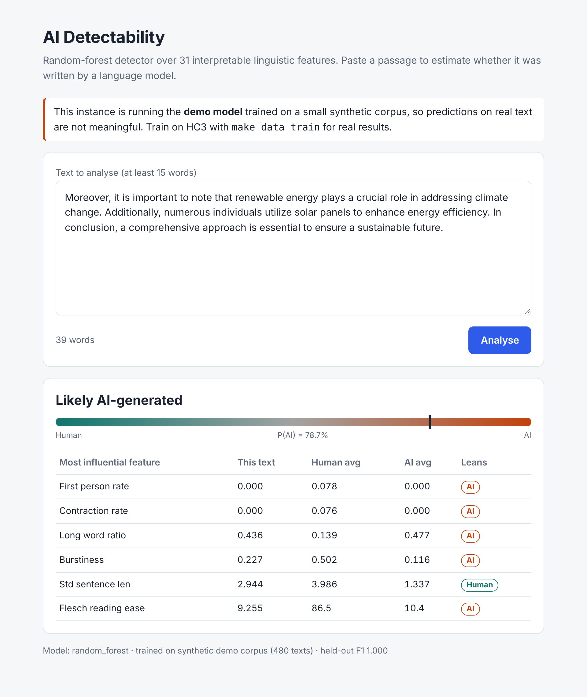

# Analysing the Temporal Decay of AI Detectability

[](https://github.com/JamieCrock/ai_detectability_decay/actions/workflows/ci.yml)


[](LICENSE)

My BSc Computer Science with AI dissertation at Swansea University asked how quickly AI-text detectors lose their edge once generated text is edited, again and again, to look human. The dissertation was awarded **85% (First Class)** and won the **Computer Society Prize** for the highest dissertation mark in the cohort.

This repository is an open-source rebuild of the project. It includes:

- **An AI-text detector** with a random forest over 31 interpretable linguistic features, served through a small web app that explains each prediction.
- **Three comparison detectors** (gradient boosting, logistic regression, and a TF-IDF lexical baseline), all evaluated on accuracy, precision, recall, F1, ROC-AUC and false-positive rate.
- **A decay experiment.** Held-out AI text goes through successive evasion transformations, and an exponential decay model is fitted to each detector's detection-rate curve to give a decay constant, a "detectability half-life" and an asymptotic floor.


<sub>The web app running the bundled demo model. Run <code>make data train</code> to serve a model trained on real data.</sub>

## Dissertation headline results

| | |
|---|---|
| Primary detector | Random forest on linguistic features |
| Detection accuracy | **97%** across test sets |
| Scale of decay analysis | **750,000** samples across multiple detection models |
| Evaluation | Accuracy, precision, recall, F1 and a comparison across detectors |

You can regenerate the full comparison and decay tables with `make compare` and `make decay`. They are written to `results/`.

## Quick start

```bash
git clone https://github.com/JamieCrock/ai_detectability_decay.git
cd ai_detectability_decay
python -m venv .venv && source .venv/bin/activate
make install

make demo      # trains a demo model on a synthetic corpus in a few seconds (no download)
make serve     # http://127.0.0.1:8000
```

**On real data** (the [HC3](https://huggingface.co/datasets/Hello-SimpleAI/HC3) corpus of human and ChatGPT answers, about 74 MB):

```bash
make data                      # download HC3
make compare                   # train and evaluate all four detectors
make decay                     # run the successive-transformation experiment
detectability serve            # the site now serves the HC3-trained random forest
```

`train` and `decay` accept `--max-samples` for a stratified subsample. You can also pass your own CSV or JSONL file with `text` and `label` columns through `--data`.

**Docker:** `docker build -t ai-detectability . && docker run -p 8000:8000 ai-detectability`

## How it works

### 1. Linguistic features (`features.py`)

All 31 features use only the standard library and NumPy, so each prediction can be explained in plain terms.

| Group | Features |
|---|---|
| Structure | word and sentence counts, mean and standard deviation of sentence length, **burstiness** (coefficient of variation of sentence length), word-length statistics |
| Lexical richness | type-token ratio, hapax legomena ratio, Yule's K |
| Style | stopword, first-person and second-person rates, **contraction rate**, **discourse-marker rate** ("moreover", "in conclusion"), hedging rate |
| Punctuation and characters | per-word rates of commas, semicolons, colons, exclamation marks, question marks, dashes, brackets and quotes; uppercase and digit ratios; character entropy |
| Readability and repetition | Flesch reading ease, repeated-bigram rate, paragraph rate |

Instruction-tuned LLMs tend to write evenly paced sentences with heavy use of connectives and few contractions or first-person pronouns. Human writing is burstier and more informal.

### 2. Detectors (`models.py`)

| Detector | Input | Classifier |
|---|---|---|
| `random_forest` (primary) | linguistic features | `RandomForestClassifier` (300 trees, balanced classes) |
| `gradient_boost` | linguistic features | `HistGradientBoostingClassifier` |
| `logistic` | standardised linguistic features | `LogisticRegression` |
| `tfidf_logistic` | word 1–2-gram TF-IDF | `LogisticRegression` |

Each fitted model is saved as a `ModelBundle`. A bundle stores the pipeline together with its held-out metrics, its feature importances and the mean feature values for each class. The web app uses these to show which features drove each prediction and whether the text looks more like the human average or the AI average.

### 3. Evasion transformations (`transforms.py`)

There are eight seeded, meaning-preserving edits that copy what people actually do to avoid detectors:

`synonym_swap` · `contract` · `drop_discourse_markers` · `vary_sentence_length` · `insert_fillers` · `punctuation_shift` · `typo_noise` · `sentence_swap`

A `TransformationSchedule` applies *k* randomly chosen transforms in each generation. Each generation **builds on the one before**, so generation *t* is an edit of generation *t − 1*. Runs are fully reproducible for a given seed.

### 4. Modelling the decay (`decay.py`)

For every detector, the detection rate *D(t)* (recall on the AI class) is measured at each generation and fitted with:

$$D(t) = D_\infty + (D_0 - D_\infty)\,e^{-\lambda t}$$

- **λ (decay constant):** how quickly detectability falls away
- **t½ = ln 2 / λ:** the *detectability half-life*, which is the number of generations before half of the eventual loss has happened
- **D∞ (floor):** the detection rate the detector settles at, however much the text is edited
- **Evasion effectiveness:** 1 − D(t)/D(0)

The experiment also tracks how key features drift across generations (burstiness, contraction rate, discourse-marker rate and others). This shows *why* each detector degrades as well as how far.

Outputs saved to `results/` are `decay_curves.csv`, `decay_fits.csv`, `feature_drift.csv`, an `example_trajectory.csv` that follows one document through every generation, a Markdown summary table and `decay_curves.png`.

## Project structure

```
src/detectability/
├── features.py      # 31 linguistic features
├── models.py        # detector pipelines + ModelBundle (persistence & explanation metadata)
├── evaluate.py      # metrics and detector comparison
├── transforms.py    # evasion transformations + TransformationSchedule
├── decay.py         # decay experiment, exponential fit, plots
├── data.py          # HC3 / CSV / JSONL loaders, stratified sampling
├── synthetic.py     # tiny synthetic corpus for tests and the demo
├── cli.py           # `detectability demo|train|decay|predict|serve`
└── web/             # FastAPI app + single-page front end
tests/               # pytest suite (features, transforms, models, decay, data, API, CLI)
```

## Testing

```bash
make test   # pytest with coverage
make lint   # ruff
```

CI runs the linter and the test suite on Python 3.11–3.13. It also builds the Docker image and smoke-tests the running API.

## Limitations and responsible use

AI-text detectors are probabilistic. False positives happen more often with short texts, formulaic writing and writing by non-native English speakers. A score from this tool, or any detector, should never be the only evidence that someone used AI. The point of this project is that detectability is **not stable**: light editing steadily wears it down, and the decay analysis measures by how much.

## Acknowledgements

- HC3 dataset: Guo et al., *How Close is ChatGPT to Human Experts? Comparison Corpus, Evaluation, and Detection* (2023), released under CC BY-SA 4.0.
- Supervised at Swansea University, Department of Computer Science.

## Licence

MIT © 2026 Jamie Crockett
